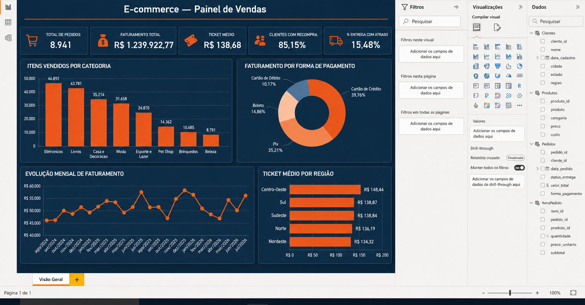
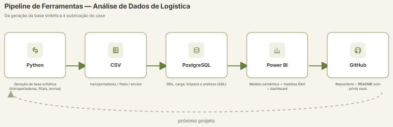
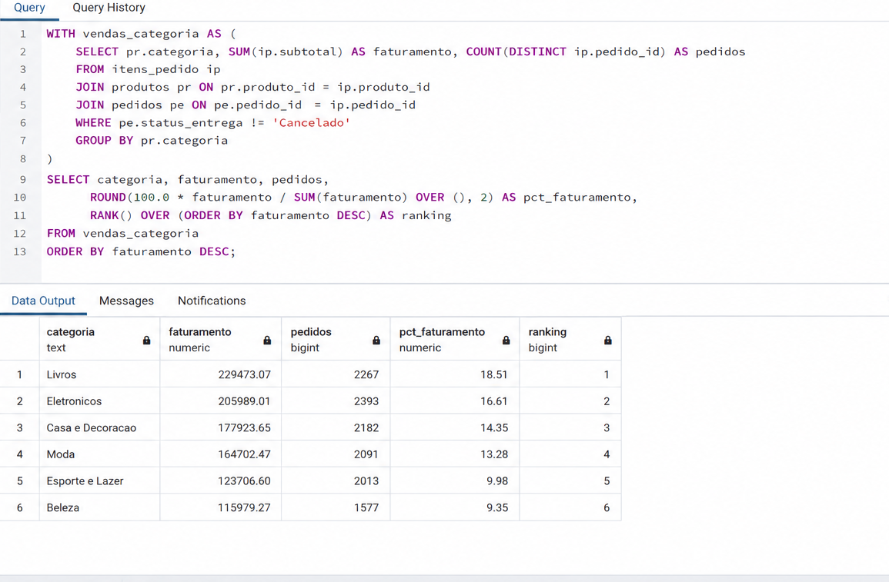
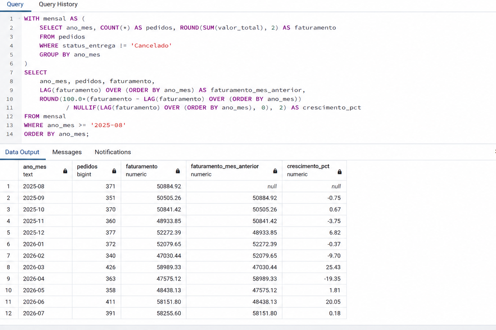
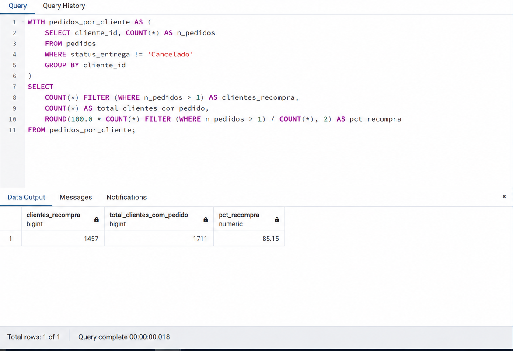
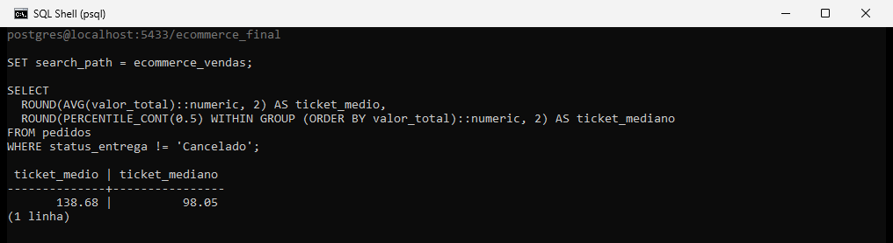

# Análise de Dados na Prática: Comportamento de Vendas em um E-commerce

Projeto de portfólio de Vitor Franca, engenheiro civil migrando para análise de dados. Dashboard em Power BI (arquivo `EcommerceVendas.pbip` na raiz do repositório).





## A base

A base é sintética, gerada em Python com distribuição realista (Pareto para volume de compra por cliente, lognormal para preço de produto), mas tratada com o mesmo rigor de uma base real: 1.800 clientes, 120 produtos em 8 categorias, 9.500 pedidos e 18.648 itens de pedido. O schema fica isolado em `ecommerce_vendas` (não em `public`), com PKs, FKs e CHECK constraints nas colunas categóricas, e todos os números abaixo saíram de execução real das queries em `02_sql/04_analises.sql` contra essa base, num PostgreSQL local.

Descontando os 559 pedidos cancelados (5,88% do total), o e-commerce fatura R$ 1.239.922,77 em 8.941 pedidos válidos, com ticket médio de R$ 138,68 e ticket mediano de R$ 98,05 — a diferença entre os dois já entrega um insight: a média está puxada por um grupo menor de pedidos de valor alto, então olhar só o ticket médio esconde o comportamento típico do cliente. Só os cancelados ficam fora do faturamento: os 778 pedidos com status "Em Transito" entram na conta, embora a entrega ainda não tenha sido concluída. Já os 15,48% de atraso são sobre os 9.500 pedidos (1.471 pedidos), cancelados incluídos; sobre os 8.941 pedidos válidos o percentual seria 16,45%. Mesmo assim é alto o suficiente pra virar prioridade de investigação numa operação real.

Livros lidera o faturamento por categoria com R$ 229.473,07 (18,51% do total), seguido de perto por Eletrônicos com R$ 205.989,01 (16,61%); as duas categorias sozinhas respondem por mais de um terço do faturamento. Cartão de Crédito é a forma de pagamento mais usada (39,76% dos pedidos, R$ 478.594,17 em faturamento), com Pix logo atrás (35,21%, R$ 449.896,45) — juntos cobrem quase 75% do volume. A Região Sudeste concentra o maior volume absoluto (3.695 pedidos, R$ 512.998,15), mas o Centro-Oeste tem o maior ticket médio entre todas as regiões (R$ 148,44), o que sugere um perfil de compra diferente e vale investigar à parte. Entre os clientes que fizeram pelo menos um pedido válido, 85,15% voltaram a comprar mais de uma vez (1.457 de 1.711). O número é alto porque a base é sintética, com 9.500 pedidos para 1.800 clientes, então ele não diz nada sobre fidelidade de clientes reais. Vale só como exemplo do método de cálculo, não como comportamento de clientes de verdade.

## Como o projeto foi montado

**Extração e modelagem dos dados.** A base foi gerada em Python (`gerar_base.py`), simulando clientes, catálogo de produtos, pedidos e itens de pedido com distribuições estatísticas que imitam padrões reais de e-commerce (poucos clientes concentrando grande parte das compras, descontos aplicados de forma não uniforme, atraso de entrega como exceção e não regra).

**Tratamento e análise em SQL.** As tabelas foram criadas com schema próprio e constraints (`01_criar_tabelas.sql`), os CSVs carregados via `\copy` com delimitador `;` (`02_carregar_dados.sql`), e a limpeza cobriu checagem de nulos, outliers em `valor_total` via `PERCENTILE_CONT` e criação de colunas derivadas como `ano_mes` (`03_limpeza.sql`). As análises finais (`04_analises.sql`) usam CTE, window functions (`RANK()`, `SUM() OVER()`), `PERCENTILE_CONT` e `FILTER` para chegar nos números de faturamento, cancelamento, recompra e ranking de clientes.







Ticket médio contra ticket mediano, sem os pedidos cancelados. A média (R$ 138,68) fica 41% acima da mediana (R$ 98,05):



**Dashboard em Power BI.** O modelo semântico (`EcommerceVendas.SemanticModel`) conecta as quatro tabelas por relacionamento de chave estrangeira e centraliza as medidas DAX (Faturamento Total, Ticket Médio, % Cancelado, % Atrasado, Clientes com Recompra %, entre outras). O relatório (`EcommerceVendas.Report`) traz cards de KPI, faturamento por categoria, distribuição por forma de pagamento, evolução mensal de faturamento e ticket médio por região.

## Como reproduzir

Precisa de PostgreSQL com o `psql` no PATH e de um terminal aberto na raiz do repositório, porque os caminhos do `\copy` em `02_sql/02_carregar_dados.sql` são relativos (`03_dados/...`). Primeiro a codificação do cliente e o banco:

```
export PGCLIENTENCODING=UTF8        # no PowerShell: $env:PGCLIENTENCODING = "UTF8"
psql -U postgres -c "CREATE DATABASE ecommerce_db"
```

Depois os quatro scripts, nesta ordem:

```
psql -U postgres -d ecommerce_db -v ON_ERROR_STOP=1 -f 02_sql/01_criar_tabelas.sql
psql -U postgres -d ecommerce_db -v ON_ERROR_STOP=1 -f 02_sql/02_carregar_dados.sql
psql -U postgres -d ecommerce_db -v ON_ERROR_STOP=1 -f 02_sql/03_limpeza.sql
psql -U postgres -d ecommerce_db -v ON_ERROR_STOP=1 -f 02_sql/04_analises.sql
```

Ajuste usuário, host e porta conforme a sua instalação. O `01` apaga e recria o schema `ecommerce_vendas`. O `04` não roda sem o `03`, porque a coluna `ano_mes` de `pedidos` só passa a existir na limpeza e a análise de evolução mensal depende dela. Ao final, o faturamento total sai R$ 1.239.922,77.

Os CSVs de `03_dados/` podem ser gerados de novo com `python gerar_base.py`, também na raiz (só usa a biblioteca padrão do Python). O script usa a semente 42 e, nos testes com Python 3.12, reproduziu os quatro CSVs idênticos aos publicados, byte a byte. Ele sobrescreve os arquivos de `03_dados/`.

## Estrutura do repositório

`02_sql/` reúne os quatro scripts SQL (criação, carga, limpeza, análises). `03_dados/` tem os CSVs sintéticos com delimitador `;`. `06_prints/` guarda o fluxograma do pipeline e o print da consulta. `EcommerceVendas.pbip`, `EcommerceVendas.SemanticModel` e `EcommerceVendas.Report` compõem o projeto Power BI.

## O que o dashboard mostra

Faturamento total, ticket médio e mediano, taxa de cancelamento e de atraso na entrega ficam nos cards do topo. Um gráfico de barras mostra o volume de itens vendidos por categoria, um donut mostra a participação de cada forma de pagamento no faturamento, uma linha temporal mostra a evolução mensal do faturamento entre agosto de 2024 e julho de 2026, e um último gráfico compara o ticket médio entre as cinco regiões do país.

## Autor

Vitor Franca, engenheiro civil em transição estruturada para análise de dados, com projetos práticos em SQL, Python e Power BI documentados neste GitHub.
